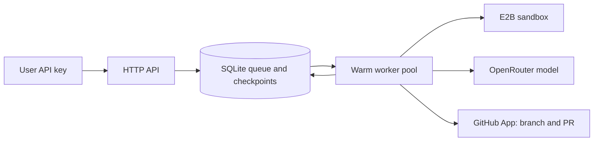

# Cloud Agent

Cloud Agent runs coding tasks in isolated [E2B](https://e2b.dev) sandboxes and opens GitHub pull requests with the resulting changes.

It ships in two modes:

- **Multi-user API**: an HTTP service with a web dashboard, a persistent SQLite queue, and a pool of warm workers.
- **Single-run CLI**: runs one task in a fresh sandbox, then exits.

## Contents

- [How it works](#how-it-works)
- [Requirements](#requirements)
- [Configuration](#configuration)
- [Running the API](#running-the-api)
- [API reference](#api-reference)
- [Single-run CLI](#single-run-cli)
- [Development](#development)
- [Troubleshooting](#troubleshooting)

## How it works



- An admin creates users and gives each one a list of allowed repositories. Users can submit tasks and see only their own tasks.
- Each worker starts a sandbox before it claims a task, so tasks start on a warm sandbox.
- The scheduler runs at most one task per user at a time, so users share the pool fairly. Requests to free models share one rate limit across all workers.

### Recovery

- After every completed model or tool turn, the worker saves the conversation and a Git patch to SQLite.
- If a run fails, the worker stops that sandbox and puts the task back in the queue. Another worker applies the saved patch in a fresh sandbox and continues from the next turn.
- Leases and heartbeats return tasks to the queue if the service process crashes.
- A task gets at most three attempts.
- Before publishing, the worker checks for an existing pushed branch or open PR, so a retry does not create a duplicate.

Recovery resumes from the **last completed turn**. A tool command interrupted before its checkpoint may run again, so task commands should be safe to repeat.

## Requirements

- [Bun](https://bun.sh) 1.3.11 or later
- An [OpenRouter](https://openrouter.ai) API key
- An [E2B](https://e2b.dev) API key
- A GitHub App with these repository permissions, installed on every repository the agent will use:
  - **Contents**: Read and write
  - **Pull requests**: Read and write
- The GitHub App ID and its private key (`.pem` file)

## Configuration

Copy the example file and fill in your keys:

```sh
cp apps/agent/.env.example apps/agent/.env
```

```dotenv
OPENROUTER_API_KEY=your-openrouter-key
E2B_API_KEY=your-e2b-key
GITHUB_APP_ID=your-app-id
GITHUB_INSTALLATION_ID=your-installation-id
GITHUB_APP_PRIVATE_KEY_PATH=/absolute/path/to/your-app-key.pem
CLOUD_AGENT_ADMIN_KEY=a-random-secret-at-least-32-characters-long
CLOUD_AGENT_WORKERS=2
CLOUD_AGENT_HOST=127.0.0.1
CLOUD_AGENT_PORT=3000
CLOUD_AGENT_DB_PATH=data/tasks.sqlite
```

| Variable | Purpose |
| --- | --- |
| `OPENROUTER_API_KEY` | Model access through OpenRouter |
| `E2B_API_KEY` | Sandbox access |
| `GITHUB_APP_ID` | Your GitHub App's ID |
| `GITHUB_INSTALLATION_ID` | Used by the CLI only. The API looks up the installation for each repository. |
| `GITHUB_APP_PRIVATE_KEY_PATH` | Absolute path to the App's private key |
| `CLOUD_AGENT_ADMIN_KEY` | Admin secret, at least 32 characters. Generate one with `openssl rand -hex 32`. |
| `CLOUD_AGENT_WORKERS` | Number of warm workers |
| `CLOUD_AGENT_HOST` / `CLOUD_AGENT_PORT` | Address the service listens on |
| `CLOUD_AGENT_DB_PATH` | SQLite database path, relative to `apps/agent` |

> [!IMPORTANT]
> `.env` and `*.pem` files are gitignored. Keep the private key outside the repository if you can.

> [!NOTE]
> The service listens on localhost by default. Put it behind a TLS reverse proxy with access controls before you expose it to other machines. Warm sandboxes use E2B resources even when idle.

## Running the API

From the repository root:

```sh
bun install --frozen-lockfile
cd apps/agent
bun run serve
```

Open <http://127.0.0.1:3000> for the dashboard.

**As admin**, sign in with `CLOUD_AGENT_ADMIN_KEY` to add members, assign repositories, and watch the queue. Each member's API key is shown only once, so copy it when it appears.

**As a member**, sign in with your own key to:

- submit tasks
- follow the current phase and completed model steps
- send more instructions while a task is running
- open the resulting pull request

The dashboard refreshes every five seconds. The step meter shows how much of the step budget has been used; it is not a time estimate. Member keys are kept in the current browser tab, and the admin key is kept only in page memory.

### Example: create a user and submit a task

Create a user (replace `ADMIN_KEY`):

```sh
curl -X POST http://127.0.0.1:3000/v1/admin/users \
  -H 'Authorization: Bearer ADMIN_KEY' \
  -H 'Content-Type: application/json' \
  -d '{"name":"Alice","repos":["owner/repo"]}'
```

The response contains a `ca_...` API key, shown once. Give it to the user.

Submit a task with that key (replace `USER_KEY`):

```sh
curl -X POST http://127.0.0.1:3000/v1/tasks \
  -H 'Authorization: Bearer USER_KEY' \
  -H 'Content-Type: application/json' \
  -d '{"repo":"owner/repo","task":"Improve the README","model":"openrouter/free","maxSteps":25}'
```

The default API model is `openrouter/free`.

## API reference

All requests use `Authorization: Bearer <key>`.

### Admin

| Method | Path | Body | Description |
| --- | --- | --- | --- |
| `POST` | `/v1/admin/users` | `{"name","repos":[...]}` | Create a user and return their API key |
| `POST` | `/v1/admin/users/{userId}/repos` | `{"repo":"owner/name"}` | Allow another repository |

### Users

| Method | Path | Body | Description |
| --- | --- | --- | --- |
| `GET` | `/v1/me` | | Your user and allowed repositories |
| `POST` | `/v1/tasks` | `{"repo","task","model","maxSteps"}` | Submit a task |
| `GET` | `/v1/tasks` | | List your tasks |
| `GET` | `/v1/tasks/{id}` | | Task status, with the PR URL when files changed |
| `POST` | `/v1/tasks/{id}/instructions` | `{"text":"..."}` | Send guidance to a queued or running task |
| `GET` | `/v1/tasks/{id}/instructions` | | List instructions and whether the agent received them |
| `POST` | `/v1/tasks/{id}/continue` | `{"text":"..."}` | Run more work on a succeeded task |

### Public

| Method | Path | Description |
| --- | --- | --- |
| `GET` | `/health` | Number of available warm sandboxes |

Task states are `queued`, `running`, `succeeded`, and `failed`.

**Instructions** are added before the worker's next model step and marked delivered in the same transaction as the checkpoint.

**Continue** queues another run of a succeeded task, passes the previous report as context, and updates the existing PR if it is still open. A failed task cannot be continued; submit a new one.

### Storage

The SQLite database and Git patches live in `apps/agent/data/` by default. The queue survives service restarts. Back up the database to move tasks to another machine. Each patch is limited to 2 MB.

## Single-run CLI

```sh
cd apps/agent
bun run start --repo owner/name --task "Fix the failing tests" --model openrouter/free
```

| Option | Required | Description |
| --- | --- | --- |
| `--repo` | yes | Target repository, `owner/name` |
| `--task` | yes | What the agent should do |
| `--model` | no | Defaults to `google/gemini-3-flash-preview`, which may cost money |
| `--max-steps` | no | 1 to 50 |

The CLI uses `GITHUB_INSTALLATION_ID` from `.env`. It starts a fresh sandbox, and when the run ends it stops the sandbox and revokes the GitHub token. Free-model calls are paced and briefly retried on per-minute rate limits.

## Development

```sh
cd apps/agent
bun run check-types
bun run test
```

The tests cover API authorization, queue claims and recovery, conversation resume, Git patch restoration, GitHub PR requests, and rate limiting. They need no live credentials.

## Troubleshooting

**`GitHub App cannot access owner/repo`**

1. Open the GitHub App's **Install App** page and check that it is installed on the repository owner.
2. If the installation is limited to selected repositories, add the repository under **Repository access**.
3. Check that `GITHUB_APP_ID` and `GITHUB_APP_PRIVATE_KEY_PATH` belong to the same App.

This error ends the task after one attempt. After you fix the permissions, submit a new task.
